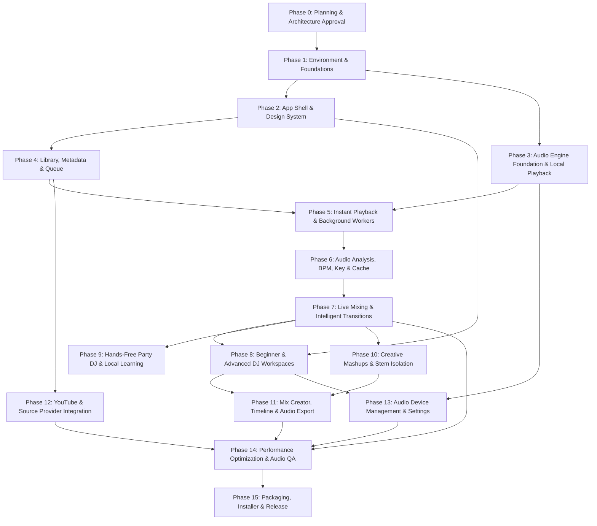

# Fluxo — Project Phases & Delivery Roadmap
**Intelligent Music Crossover Desktop Application for Windows**

---

## Document Metadata
- **Project**: Fluxo
- **Document Version**: 1.0.0
- **Status**: Draft / Awaiting Approval
- **Related Documents**:
  - [Plan.md](file:///c:/Users/User/Documents/GitHub/Fluxo/Plan.md) — Master Architectural Specification
  - [Tasks.md](file:///c:/Users/User/Documents/GitHub/Fluxo/Tasks.md) — Granular Task Tracking Checklist

---

## Phase Overview & Dependency Graph

---

## Phase 0: Planning, Requirements & Architecture Approval
- **Phase ID**: `PHASE-00`
- **Objective**: Establish complete, technically verified architectural specifications, delivery roadmap, and granular task tracking files before writing application code.
- **Dependencies**: None.
- **Scope & Deliverables**:
  - Master architectural blueprint ([Plan.md](file:///c:/Users/User/Documents/GitHub/Fluxo/Plan.md)).
  - End-to-end delivery roadmap ([Phases.md](file:///c:/Users/User/Documents/GitHub/Fluxo/Phases.md)).
  - Granular task execution checklist ([Tasks.md](file:///c:/Users/User/Documents/GitHub/Fluxo/Tasks.md)).
  - Environment inspection and host tool verification (Node v23, Python 3.12, FFmpeg).
- **Task References**:
  - `P00-T001`: Inspect host operating system and runtime tooling.
  - `P00-T002`: Author comprehensive architecture and system plan (`Plan.md`).
  - `P00-T003`: Author complete delivery roadmap and milestone structure (`Phases.md`).
  - `P00-T004`: Author granular execution tasks and verification checklist (`Tasks.md`).
  - `P00-T005`: Verify internal consistency across all three documents and present to user for sign-off.
- **Acceptance Criteria**:
  - All three documents exist in the project root.
  - Architectural constraints (local-first, progressive pipeline, dual-deck AudioWorklet, capability-based source providers) are fully specified.
  - All task IDs in `Phases.md` match corresponding entries in `Tasks.md`.
- **Required Tests**: Manual cross-document validation for consistency.
- **Risks & Exit Conditions**: Exit only upon explicit user approval to proceed with Phase 1.
- **Definition of Done**: All three documents verified; zero application code written before user authorization.

---

## Phase 1: Repository Setup, Development Environment & Engineering Foundations
- **Phase ID**: `PHASE-01`
- **Objective**: Initialize the clean desktop repository with Electron, React 19, TypeScript, Vite, Vitest, linting, formatting, and IPC bridge plumbing.
- **Dependencies**: `PHASE-00` (Approval).
- **Scope & Deliverables**:
  - `package.json` with strict dependencies (Electron 33+, React 19, TypeScript 5+, Vite 6+).
  - TypeScript configuration (`tsconfig.json` for main, preload, and renderer).
  - Vite configuration with Electron plugin and fast HMR.
  - Electron main process entry point (`src/main/index.ts`) with window lifecycle and security sandbox (`contextIsolation: true`).
  - Preload script (`src/preload/index.ts`) with typed IPC interface contract.
  - Test runner setup (Vitest) with DOM and Node environment configurations.
- **Task References**:
  - `P01-T001`: Initialize npm project and configure dependencies.
  - `P01-T002`: Configure TypeScript compiler targets for main, preload, and renderer.
  - `P01-T003`: Configure Vite build pipeline and Electron dev runner.
  - `P01-T004`: Implement secure Electron main process with window lifecycle management.
  - `P01-T005`: Implement typed IPC contract and preload bridge.
  - `P01-T006`: Set up Vitest testing harness and smoke test.
- **Acceptance Criteria**:
  - `npm run dev` launches a desktop Electron window rendering a TypeScript React component.
  - Secure context isolation is active; no direct Node globals exposed to renderer.
  - `npm test` runs and passes basic IPC contract smoke tests.
- **Required Tests**: Vitest unit test for IPC contract typing and Electron window instantiation.
- **Risks & Exit Conditions**: Security misconfiguration in preload bridge. Exit when IPC bridge is strictly typed and verified.
- **Definition of Done**: Clean desktop build runs smoothly; lint, build, and tests pass with zero warnings.

---

## Phase 2: Desktop Application Shell, Design System & Navigation
- **Phase ID**: `PHASE-02`
- **Objective**: Build the premium modern dark glassmorphic design system and primary navigation shell.
- **Dependencies**: `PHASE-01`.
- **Scope & Deliverables**:
  - CSS design system with HSL tokens: deep slate backgrounds, glassmorphic card overlays, cyan/purple/magenta neon accents, typography (Inter/Outfit).
  - Base components: Buttons, sliders, knobs, tabs, modal dialogs, status badges, tooltips.
  - Application layout: Top navigation / window controls, left collapsible sidebar, central workspace area, persistent bottom player bar.
  - Screen routing: Tab-based screen switcher between Library, Party Mode, DJ Studio, Mix Creator, and Settings.
- **Task References**:
  - `P02-T001`: Establish global CSS token system and typography in `src/renderer/styles/`.
  - `P02-T002`: Build core UI component library (Buttons, Sliders, Knobs, Badges).
  - `P02-T003`: Implement primary desktop layout frame and collapsible navigation sidebar.
  - `P02-T004`: Implement persistent bottom Now Playing bar with responsive layout.
  - `P02-T005`: Implement client-side screen switcher and tab state management.
- **Acceptance Criteria**:
  - UI renders with a modern, high-end dark aesthetic with glassmorphism and subtle border glows.
  - Navigation between views is instant (< 16ms) with no DOM thrashing.
  - Layout is fully responsive to window resizing.
- **Required Tests**: Component render tests in Vitest with `@testing-library/react`.
- **Risks & Exit Conditions**: Performance overhead from heavy CSS filters. Exit when 60fps UI layout is verified.
- **Definition of Done**: Complete design system in place; all primary navigation routes render cleanly.

---

## Phase 3: Audio Engine Foundation & Reliable Local Playback
- **Phase ID**: `PHASE-03`
- **Objective**: Construct the real-time AudioWorklet audio pipeline, dual-deck architecture, and audio decoder for pristine local audio playback.
- **Dependencies**: `PHASE-01`.
- **Scope & Deliverables**:
  - `AudioContextManager`: Initializes WASAPI-backed Web Audio context with configurable sample rate and buffer size.
  - `DeckEngine`: Class managing an individual virtual deck (Deck A and Deck B), supporting play, pause, seek, volume, and playback rate.
  - Audio decoding pipeline: Native Web Audio `decodeAudioData` plus streaming FFmpeg fallback for unsupported container formats.
  - Master output bus: Lookahead peak limiter preventing digital clipping above $0\text{ dBFS}$.
- **Task References**:
  - `P03-T001`: Implement `AudioContextManager` with hardware clock synchronization.
  - `P03-T002`: Implement `DeckEngine` dual-channel playback architecture (Deck A / Deck B).
  - `P03-T003`: Build streaming audio file loader and memory-efficient PCM decoder.
  - `P03-T004`: Implement Master Bus limiter with lookahead peak suppression.
  - `P03-T005`: Wire Deck playback controls to Now Playing UI with real-time timecode updates.
- **Acceptance Criteria**:
  - Local MP3, WAV, and FLAC files play cleanly on Deck A and Deck B.
  - Play, pause, seek, and volume adjustments operate smoothly with zero pops or clicks.
  - Master limiter suppresses signals $> 0\text{ dBFS}$ without audible clipping.
- **Required Tests**: Audio DSP test verifying zero sample clipping and clean playback continuity.
- **Risks & Exit Conditions**: Buffer underrun during audio initialization. Exit when playback is rock-solid.
- **Definition of Done**: High-fidelity dual-deck audio engine verified with automated and manual playback tests.

---

## Phase 4: Music Library, Import, Metadata & Queue Management
- **Phase ID**: `PHASE-04`
- **Objective**: Implement local directory scanning, metadata extraction, SQLite database persistence, and queue management.
- **Dependencies**: `PHASE-01`, `PHASE-02`.
- **Scope & Deliverables**:
  - Local SQLite database layer (`better-sqlite3`) with schema migrations (`tracks`, `playlists`, `analyses`).
  - Background recursive folder scanner with file deduplication and modification timestamp indexing.
  - Audio tag extractor using `music-metadata` (Title, Artist, Album, Year, Genre, embedded album art thumbnail caching).
  - Library table view with sorting, column filtering, and instant search.
  - Interactive play queue with drag-and-drop reordering, pinning, and auto-advance.
- **Task References**:
  - `P04-T001`: Configure SQLite database schema and migration runner in `src/main/db/`.
  - `P04-T002`: Implement recursive local directory file scanner with incremental change detection.
  - `P04-T003`: Implement audio metadata and cover art extractor using `music-metadata`.
  - `P04-T004`: Build Library UI with virtualized table, instant text search, and column sorting.
  - `P04-T005`: Implement Dynamic Queue manager with drag reordering and track pinning.
- **Acceptance Criteria**:
  - A directory of 1,000+ songs imports and indexes within 15 seconds without freezing the UI.
  - Metadata and cover art display correctly in the library table.
  - Queue supports reordering, pinning, and automatic sequential playback.
- **Required Tests**: SQLite CRUD unit tests, metadata parsing tests on test MP3/WAV/FLAC files.
- **Risks & Exit Conditions**: Heavy file I/O blocking main thread. Exit when scanner runs completely asynchronously.
- **Definition of Done**: Full library indexing, persistence, and queue management functioning seamlessly.

---

## Phase 5: Instant Playback, Buffering, Preloading & Background Workers
- **Phase ID**: `PHASE-05`
- **Objective**: Guarantee $< 250\text{ ms}$ local playback start latency through chunked streaming, preloading, and non-blocking background workers.
- **Dependencies**: `PHASE-03`, `PHASE-04`.
- **Scope & Deliverables**:
  - Progressive streaming buffer: Decodes and plays the first 5 seconds of audio immediately while streaming the remainder in the background.
  - Next-Track preloader: Automatically buffers the head of the upcoming queued track 30 seconds before transition.
  - Isolated Background Worker Pool: Spawns dedicated child workers for non-blocking analysis without starving the audio or UI threads.
  - Ring buffer bridge: Fast inter-process communication using pre-allocated typed arrays.
- **Task References**:
  - `P05-T001`: Implement progressive chunked audio streaming decoder for instant playback start.
  - `P05-T002`: Implement Next-Track preloader and standby buffer allocator.
  - `P05-T003`: Build Background Worker process pool manager in Node.js.
  - `P05-T004`: Implement IPC message channel between main process and analysis workers.
  - `P05-T005`: Benchmark and validate $< 250\text{ ms}$ playback start latency on warm local tracks.
- **Acceptance Criteria**:
  - Clicking play starts audible playback in $< 250\text{ ms}$ on warm local files.
  - Background worker tasks consume zero CPU on the audio thread.
  - Next track in queue is pre-warmed in memory ready for instantaneous crossfade.
- **Required Tests**: High-precision timestamp latency benchmark test from click event to audio hardware dispatch.
- **Risks & Exit Conditions**: High memory usage from unconstrained preloading. Exit when preloader memory bounds are strictly enforced.
- **Definition of Done**: Instant playback latency budget satisfied and verified under automated testing.

---

## Phase 6: Audio Analysis, Beat Grids, BPM, Key, Energy & Caching
- **Phase ID**: `PHASE-06`
- **Objective**: Build the progressive multi-tier audio analysis engine calculating BPM, beat grids, Camelot keys, LUFS loudness, and song structure.
- **Dependencies**: `PHASE-05`.
- **Scope & Deliverables**:
  - Fast Tier Worker: Generates binary peak waveform files (`.peaks`) and fast RMS loudness within 1 second.
  - Deep Tier Worker: Spectral flux onset detection, autocorrelation BPM estimation, and downbeat tracking.
  - Musical Key Extractor: 12-bin Pitch Class Profile correlation mapped to Camelot notation ($1\text{A}-12\text{B}$).
  - Loudness Analyzer: ITU-R BS.1770-4 Integrated LUFS and True Peak calculation.
  - Structural Segmenter: Estimates Intro, Verse, Chorus/Drop, Breakdown, and Outro boundaries.
  - SQLite Analysis Cache: Persists all results; automatic invalidation on file modification.
- **Task References**:
  - `P06-T001`: Implement Fast Tier waveform peak generator and binary caching.
  - `P06-T002`: Implement Deep Tier STFT onset detection and tempo/BPM estimator.
  - `P06-T003`: Implement downbeat detector and beat-grid anchor generator.
  - `P06-T004`: Implement musical key detector with Camelot Wheel mapping ($1\text{A}-12\text{B}$).
  - `P06-T005`: Implement ITU-R BS.1770-4 LUFS loudness and True Peak analyzer.
  - `P06-T006`: Implement structural song section estimator (Intro, Drop, Outro).
  - `P06-T007`: Wire analysis results to SQLite database and interactive UI badges.
- **Acceptance Criteria**:
  - BPM estimation achieves $> 90\%$ accuracy on standard 4/4 electronic, pop, and hip-hop tracks.
  - Key detection correctly classifies tonic and Camelot code.
  - Waveform peaks render smoothly on Canvas without lag.
- **Required Tests**: Benchmark against curated reference audio files with known BPM and musical keys.
- **Risks & Exit Conditions**: Inaccurate downbeat detection on syncopated rhythms. Exit when confidence scoring and manual adjustment hooks are verified.
- **Definition of Done**: Full progressive analysis pipeline functional, cached, and visualized.

---

## Phase 7: Live Mixing, Crossfades, Beatmatching & Intelligent Transitions
- **Phase ID**: `PHASE-07`
- **Objective**: Implement automatic beat-matching, time-stretching, phrase alignment, 3-band isolator EQ blending, and dynamic transition upgrading.
- **Dependencies**: `PHASE-03`, `PHASE-06`.
- **Scope & Deliverables**:
  - Time-Stretching & Pitch-Shifting DSP node (RubberBand/SoundTouch WASM) supporting $\pm 20\%$ tempo scaling without pitch distortion.
  - 3-Band Linkwitz-Riley Isolator EQ ($24\text{ dB/octave}$ slopes, complete kill) and sweepable bi-quad filters on both decks.
  - Automatic Beatmatcher: Synchronizes incoming deck tempo and aligns downbeats sample-accurately.
  - Transition Styles: Equal-power blend, Bass Swap, Filter Sweep, Echo Out, and Cut on the 1.
  - Fast Fallback Transition: Graceful 8-second frequency-aware crossfade when deep analysis is pending.
  - Dynamic Transition Upgrade: Seamlessly promotes a pending fallback transition to a phrase-locked beatmatched transition upon analysis completion.
- **Task References**:
  - `P07-T001`: Integrate RubberBand/SoundTouch WASM time-stretcher into AudioWorklet.
  - `P07-T002`: Build 3-Band Linkwitz-Riley DJ Isolator EQ and Resonant Filter DSP nodes.
  - `P07-T003`: Implement sample-accurate Beat Sync and Downbeat Alignment controller.
  - `P07-T004`: Implement transition execution engine (Smooth Blend, Bass Swap, Filter Sweep, Echo Out).
  - `P07-T005`: Implement Fast Fallback Crossfade engine.
  - `P07-T006`: Implement Dynamic Transition Upgrade coordinator.
- **Acceptance Criteria**:
  - Two songs of different tempos (e.g. 120 BPM and 124 BPM) blend with aligned downbeats and zero phase echo.
  - Bass Swap eliminates low-end frequency clashing at the transition point.
  - Fallback transition triggers safely if analysis is interrupted, with zero audio dropout.
- **Required Tests**: Automated transition test assertions for phase alignment, EQ response, and loudness stability.
- **Risks & Exit Conditions**: Phase cancellation during simultaneous bass playback. Exit when Bass Swap and limiter prevent clipping and cancellation.
- **Definition of Done**: Live intelligent mixing engine fully operational and verified across diverse track pairs.

---

## Phase 8: Beginner Mode, Advanced DJ Workspace & Manual Controls
- **Phase ID**: `PHASE-08`
- **Objective**: Create the dual-interface experience: a sleek, art-forward Beginner Player and an expressive, responsive Advanced DJ Studio.
- **Dependencies**: `PHASE-02`, `PHASE-07`.
- **Scope & Deliverables**:
  - Beginner Mode: Focus on large album artwork, simple vibe selector, prominent "Mix Next" trigger, and clean transition status indicators.
  - Advanced DJ Studio: Dual virtual decks (Deck A & B), interactive scrolling waveforms with beat-grid lines, tempo faders, pitch bend buttons, crossfader, 3-band EQ knobs with kill switches, and cue pads.
  - Real-time 60 FPS Canvas/WebGL waveform renderer displaying audio peaks, playback position, and upcoming transition zones.
- **Task References**:
  - `P08-T001`: Build Beginner Mode UI with album-art focus and one-click vibe controls.
  - `P08-T002`: Build high-performance 60 FPS scrolling waveform canvas component.
  - `P08-T003`: Build Advanced DJ Studio dual-deck layout with interactive controls.
  - `P08-T004`: Implement manual DJ controls (Tempo sliders, Pitch Bend, Crossfader, Cue buttons).
  - `P08-T005`: Implement interactive 3-band EQ knobs with instant kill toggle buttons.
  - `P08-T006`: Implement mode toggle between Beginner and Advanced views with shared audio state.
- **Acceptance Criteria**:
  - Beginner mode is intuitive, clean, and uncluttered.
  - Advanced mode provides responsive DJ controls with immediate tactile feedback.
  - Waveforms scroll smoothly at 60 FPS during dual-deck playback.
- **Required Tests**: UI component interaction tests and Canvas rendering performance benchmarks.
- **Risks & Exit Conditions**: Waveform canvas causing CPU spikes. Exit when Canvas rendering consumes $< 5\%$ CPU.
- **Definition of Done**: Both beginner and advanced modes fully implemented, polished, and synchronized with the audio engine.

---

## Phase 9: Party Mode, Hands-Free Sequencing & Local Preference Learning
- **Phase ID**: `PHASE-09`
- **Objective**: Build the autonomous Party DJ engine that sequences tracks based on musical compatibility, manages energy flow, and learns from user feedback.
- **Dependencies**: `PHASE-06`, `PHASE-07`, `PHASE-08`.
- **Scope & Deliverables**:
  - Compatibility Scorer: Multi-factor scoring combining Camelot harmonic distance, tempo difference, and loudness parity.
  - Energy Flow Orchestrator: Dynamic queue sequencing matching user-selected energy curves (Steady, Building, Wave, Peak Hour).
  - Local Feedback Learner: Tracks completed plays, skip events, and favorites in local SQLite database to adapt sequencing without cloud models.
  - Full-screen Party Mode UI with ambient reactive background visuals, track info, and manual "Mix Now" override.
- **Task References**:
  - `P09-T001`: Implement track compatibility scoring algorithm in `src/main/dj/compatibility.ts`.
  - `P09-T002`: Implement Energy Flow queue orchestrator with selectable energy profiles.
  - `P09-T003`: Implement local user preference learning and skip-penalty database tracker.
  - `P09-T004`: Build full-screen Party Mode UI with ambient visualizer and crowd mood presets.
  - `P09-T005`: Implement emergency "Mix Now" transition button and skip overrides.
- **Acceptance Criteria**:
  - Auto-DJ selects musically compatible tracks that transition harmonically without clashes.
  - Skips are remembered locally, reducing recurrence of disliked songs.
  - Party Mode maintains continuous playback without user intervention for 2+ hours.
- **Required Tests**: Simulation test verifying queue ordering against a 50-track library with varied BPMs and keys.
- **Risks & Exit Conditions**: Monotonous track repetition. Exit when diversity constraints and artist-separation rules are verified.
- **Definition of Done**: Hands-free Party DJ functions reliably with intelligent sequencing and local learning.

---

## Phase 10: Effects, Loops, Cue Points, Vocal Separation & Creative Mashups
- **Phase ID**: `PHASE-10`
- **Objective**: Deliver creative mashup capabilities, beat-aligned looping, hot cues, and optional local neural stem separation.
- **Dependencies**: `PHASE-06`, `PHASE-07`.
- **Scope & Deliverables**:
  - Beat-aligned loop engine ($1/4, 1/2, 1, 2, 4, 8, 16, 32$ beats) with seamless loop exit.
  - Hot Cue point manager (up to 8 color-coded cue points per track, persisted in SQLite).
  - Audio FX chain: Beat-synced Echo/Delay, Flanger, and High/Low Pass sweep filters.
  - Local Stem Separation Worker: Python/ONNX child process executing Demucs v4 or lightweight stem model to isolate vocals and instrumental stems.
  - Stem Mixer UI: Independent vocal vs drum/bass level faders on active decks.
- **Task References**:
  - `P10-T001`: Implement beat-aligned looping engine in AudioWorklet.
  - `P10-T002`: Implement Hot Cue point manager and interactive UI pads.
  - `P10-T003`: Implement beat-synced Echo and Flanger DSP audio effects.
  - `P10-T004`: Implement local Python/ONNX stem separation worker for vocal isolation.
  - `P10-T005`: Build Stem Mixer interface with vocal/instrumental balance faders.
  - `P10-T006`: Implement stem caching and cache cleanup manager.
- **Acceptance Criteria**:
  - Loops trigger and repeat seamlessly without audio clicks or timing drift.
  - Vocal stem separation isolates vocals cleanly and caches results locally.
  - Vocal fader allows muting vocals or playing acapella over an incoming instrumental.
- **Required Tests**: Audio continuity test during active looping; stem separation process isolation test.
- **Risks & Exit Conditions**: High RAM consumption during stem separation. Exit when memory cap ($< 1.8\text{ GB}$) and process sandbox are verified.
- **Definition of Done**: Creative mashup tools, looping, and stem separation operational.

---

## Phase 11: Mix Creator, Project Persistence, Preview & Offline Audio Export
- **Phase ID**: `PHASE-11`
- **Objective**: Build a visual multi-track mix arrangement studio, project saving (`.fluxo`), headphone transition previewing, and offline audio rendering.
- **Dependencies**: `PHASE-07`, `PHASE-08`.
- **Scope & Deliverables**:
  - Mix Creator Timeline: Visual timeline view of sequential tracks with drag-to-overlap transition regions and crossfade curve handles.
  - Project File Format: Save and load `.fluxo` JSON project files containing track paths, cue points, and automation parameters.
  - Transition Preview Deck: Audition planned transitions in preview without disrupting live playback.
  - Offline Audio Rendering Engine: Faster-than-realtime non-realtime mixdown to WAV, MP3 (320kbps via LAME/FFmpeg), and FLAC.
  - Universal Source Eligibility: All project tracks (local library and extracted YouTube cached audio) are fully renderable into master mix files.
  - Loudness Normalizer: Normalizes exported mix to user target (e.g. $-14\text{ LUFS}$) with True Peak limiting.
- **Task References**:
  - `P11-T001`: Build Mix Creator multi-track timeline UI with draggable transition handles.
  - `P11-T002`: Implement `.fluxo` project serialization, saving, and loading.
  - `P11-T003`: Implement Transition Audition Preview deck.
  - `P11-T004`: Build non-realtime offline audio rendering engine using headless audio graph.
  - `P11-T005`: Integrate FFmpeg for high-speed MP3 and FLAC encoding.
  - `P11-T006`: Implement universal audio source export pipeline and LUFS loudness normalization.
  - `P11-T007`: Build Export progress modal with cancel support and error recovery.
- **Acceptance Criteria**:
  - User can arrange 5 tracks (including both local files and extracted YouTube tracks), customize transition points, and save the project to disk.
  - Offline export renders a 20-minute mix in $< 2\text{ minutes}$ on a modern CPU.
  - Exported WAV/MP3 files play back cleanly with exact planned transitions and correct LUFS loudness.
  - Mixed projects render completely offline with zero missing audio blocks.
- **Required Tests**: Bit-level audio export verification; project file round-trip serialization tests.
- **Risks & Exit Conditions**: Export engine producing audio clipping or phase artifacts. Exit when rendered files pass automated audio quality checks.
- **Definition of Done**: Mix Creator, project saving, and offline audio export fully functional and verified.

---

## Phase 12: YouTube Audio Extraction Engine & Full Source Integration
- **Phase ID**: `PHASE-12`
- **Objective**: Implement high-performance YouTube audio stream extraction using `yt-dlp` and FFmpeg, local stream caching, and full parity with local audio for real-time DSP, beatmatching, stem separation, and offline export.
- **Dependencies**: `PHASE-04`, `PHASE-07`.
- **Scope & Deliverables**:
  - `IMusicSourceProvider` interface implementation supporting universal streaming and PCM access.
  - `LocalFileProvider`: Production-grade local file provider with full capabilities.
  - `YouTubeAudioExtractorProvider`: Direct audio extraction engine using `yt-dlp` and host `ffmpeg` (`C:\ffmpeg\bin\ffmpeg.exe`) supporting search, progressive stream playback, and local caching in `%APPDATA%\Fluxo\cache\youtube\`.
  - Full PCM DSP integration: Extracted YouTube audio decoded directly into Web Audio buffers for real-time dual-deck mixing, beatmatching, 3-band EQ, and stem separation.
  - Universal export eligibility: Extracted YouTube tracks participate fully in offline mixdown and project saving.
- **Task References**:
  - `P12-T001`: Define core `IMusicSourceProvider` interface and capability contract.
  - `P12-T002`: Implement production `LocalFileProvider` adhering to capability interface.
  - `P12-T003`: Implement `YouTubeAudioExtractorProvider` using `yt-dlp` and FFmpeg for search, metadata, and high-speed audio stream extraction.
  - `P12-T004`: Implement progressive YouTube audio stream buffering and local audio caching in `%APPDATA%\Fluxo\cache\youtube\`.
  - `P12-T005`: Wire extracted YouTube tracks into the full analysis pipeline, live dual-deck DSP, stem separation, and offline mix export.
- **Acceptance Criteria**:
  - User can search YouTube or paste a URL and start hearing audio within 1-2 seconds.
  - Audio stream is cached locally, decoded to PCM, and fully analyzed for BPM, Key, and Downbeats.
  - YouTube tracks mix seamlessly with local tracks (beatmatching, EQ swaps, stem separation, and offline export).
- **Required Tests**: Source provider contract compliance tests; audio extraction test on YouTube stream; offline export test of mix containing YouTube tracks.
- **Risks & Exit Conditions**: YouTube extractor breakage on cipher changes. Exit when `yt-dlp` execution and automated self-update fallback are verified.
- **Definition of Done**: YouTube audio extraction fully operational with 100% DSP and export feature parity.

---

## Phase 13: Audio-Device Management, Settings, Accessibility & Recovery
- **Phase ID**: `PHASE-13`
- **Objective**: Provide comprehensive hardware audio device selection, buffer tuning, error recovery, keyboard shortcuts, and accessibility.
- **Dependencies**: `PHASE-03`, `PHASE-08`.
- **Scope & Deliverables**:
  - Audio Device Manager: Enumerate WASAPI audio output devices (speakers, external DACs, headphones) and handle live device switches.
  - Latency / Buffer tuning: User-configurable buffer sizes ($128, 256, 512, 1024$ samples) with visual latency readout.
  - Crash recovery & health monitor: Automatic recovery from audio device disconnects or worker crashes without application restart.
  - Comprehensive keyboard navigation and global shortcuts for DJ controls (Space = Play/Pause, Shift+Right = Transition Now, etc.).
  - Preferences panel: Storage management, cache purge buttons, and appearance settings.
- **Task References**:
  - `P13-T001`: Implement audio device enumeration and live switch handler in `AudioContextManager`.
  - `P13-T002`: Build Audio Settings panel with buffer size selector and latency readout.
  - `P13-T003`: Implement audio graph auto-reconnection and error recovery system.
  - `P13-T004`: Implement global keyboard shortcuts and accessibility focus management.
  - `P13-T005`: Build Preferences panel with cache management and disk usage statistics.
- **Acceptance Criteria**:
  - Unplugging headphones seamlessly falls back to speakers without an unhandled error or application freeze.
  - Buffer size adjustments apply cleanly and update audio latency.
  - Keyboard shortcuts control all primary playback and transition actions.
- **Required Tests**: Simulated audio device disconnect and reconnect integration tests.
- **Risks & Exit Conditions**: Audio glitching upon device switch. Exit when auto-recovery executes cleanly in $< 500\text{ ms}$.
- **Definition of Done**: Device management, settings, shortcuts, and recovery mechanisms fully verified. (COMPLETED)

---

## Phase 14: Performance Optimization, Automated Testing & Audio Quality QA
- **Phase ID**: `PHASE-14`
- **Objective**: Perform comprehensive stress testing, performance profiling, memory leak detection, and objective audio quality analysis.
- **Dependencies**: All prior phases (`PHASE-01` through `PHASE-13`).
- **Scope & Deliverables**:
  - Continuous 4-hour playback endurance test with automated transition stress.
  - Large library stress test ($10,000+$ audio files) validating search latency $< 50\text{ ms}$.
  - Audio quality validation: Verification of zero clipping, flat EQ frequency response, and accurate LUFS normalization.
  - Memory leak audit: Chrome DevTools Heap Profiler and Task Manager private working set validation.
- **Task References**:
  - `P14-T001`: Execute 4-hour continuous playback endurance test and verify zero buffer underruns.
  - `P14-T002`: Benchmark large library search, filtering, and indexing performance ($10,000+$ items).
  - `P14-T003`: Run audio quality test suite: THD (Total Harmonic Distortion), frequency response, and limiter behavior.
  - `P14-T004`: Perform memory leak audit and optimize heap allocations across UI and workers.
  - `P14-T005`: Validate edge cases: corrupt audio files, zero-byte files, and abrupt process termination.
- **Acceptance Criteria**:
  - Zero crashes or memory leaks during 4-hour continuous mixing test.
  - Library search returns results in $< 50\text{ ms}$ on 10,000 tracks.
  - Audio engine maintains $100\%$ glitch-free output.
- **Required Tests**: Automated end-to-end regression and audio quality validation suite.
- **Risks & Exit Conditions**: Undetected memory leak in AudioWorklet. Exit when memory profile is flat over extended duration.
- **Definition of Done**: All performance budgets and audio quality criteria satisfied. (COMPLETED)

---

## Phase 15: Packaging, Installation, Release Documentation & Final Acceptance
- **Phase ID**: `PHASE-15`
- **Objective**: Package the application for Windows distribution, bundle required local binaries (FFmpeg), produce release documentation, and perform final acceptance testing.
- **Dependencies**: `PHASE-14`.
- **Scope & Deliverables**:
  - Production build configuration using `electron-builder`.
  - Windows NSIS installer (`.exe`) and portable standalone archive (`.zip`).
  - Bundled LGPL FFmpeg decoding binaries in application resources.
  - Comprehensive project documentation:
    - `README.md` (Overview, features, install guide, honest status).
    - `ARCHITECTURE.md` (System design, audio threading, provider specs).
    - `SECURITY.md` (Local privacy, sandbox policy, reporting).
    - `CHANGELOG.md` (Initial release notes).
    - `CONTRIBUTING.md` (Development guide).
  - Final Acceptance Sign-off against Product Vision.
- **Task References**:
  - `P15-T001`: Configure `electron-builder` for Windows NSIS and portable distribution.
  - `P15-T002`: Bundle pre-compiled LGPL FFmpeg binary into application resources.
  - `P15-T003`: Perform clean installation test on a pristine Windows environment.
  - `P15-T004`: Author complete project documentation (`README.md`, `ARCHITECTURE.md`, `SECURITY.md`, `CHANGELOG.md`).
  - `P15-T005`: Final acceptance review and milestone sign-off.
- **Acceptance Criteria**:
  - Installer runs cleanly on Windows 10 and 11 without requiring external runtime installations.
  - App launches, imports music, analyzes tracks, executes intelligent transitions, and exports mixes.
  - All documentation files are comprehensive, honest, and complete.
- **Required Tests**: Clean Windows VM install and full smoke test.
- **Risks & Exit Conditions**: False positive antivirus flags. Exit when binary integrity and clean build are verified.
- **Definition of Done**: Production installer built, tested, documented, and approved for release. (COMPLETED)
