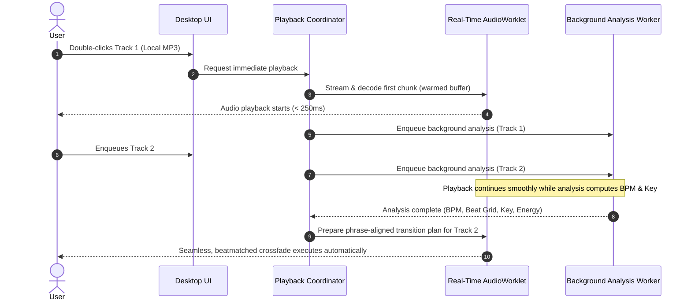

# Fluxo — Architectural Specification & Master Project Plan
**Intelligent Music Crossover Desktop Application for Windows**
*Every song. One flow. Pick the songs. Set the vibe. Let Fluxo mix.*

---

## Document Metadata
- **Project Codename**: Fluxo
- **Document Version**: 1.0.0 (Master Blueprint)
- **Status**: Draft / Awaiting Phase 0 Approval
- **Platform**: Windows 10 / Windows 11 (64-bit, x86_64)
- **Primary Execution Model**: Local-First, CPU-Optimized, Progressive Real-Time Processing
- **Related Documents**:
  - [Phases.md](file:///c:/Users/User/Documents/GitHub/Fluxo/Phases.md) — Delivery Roadmap & Milestones
  - [Tasks.md](file:///c:/Users/User/Documents/GitHub/Fluxo/Tasks.md) — Granular Task Tracking & Verification Checklist

---

## 1. Product Vision & Problem Statement

### 1.1 The Problem
Creating seamless transitions, beatmatched mixes, and creative mashups has historically required professional DJ hardware, complex digital audio workstations (DAWs), or specialized DJ software (such as Serato, Traktor, or Rekordbox). Ordinary music listeners, house party hosts, casual listeners, and fitness instructors want continuous, rhythmically coherent music experiences without jarring gaps, awkward tempo clashes, key dissonance, or having to learn manual beatmatching, cueing, EQ blending, and phrasing.

Existing automated solutions fall into two unsatisfying extremes:
1. **Generic Music Players**: Offer crude 3–12 second volume crossfades that clash musically, creating chaotic rhythm collisions ("trainwrecks"), muddy bass frequencies, and awkward vocal overlaps.
2. **Professional DJ Software "Automix"**: Complex, intimidating interfaces with steep learning curves, requiring extensive track pre-analysis and manual configuration before anything can be played.
3. **Cloud-Based AI Remixers**: Require subscription fees, upload user audio files to remote servers (violating privacy and consuming heavy bandwidth), introduce high latency, and lack real-time local control.

### 1.2 The Fluxo Vision
**Fluxo** is an intelligent, free, local-first Windows desktop application that bridges this gap. It acts as an **intelligent party DJ that lets anyone mix songs seamlessly without learning how to DJ**.

Users can select a track, begin listening instantly, queue subsequent songs, and experience rhythmically locked, harmonically compatible, phrase-aligned transitions powered by a progressive local audio analysis engine. For power users and curious creators, Fluxo seamlessly unfolds into an advanced dual-deck DJ studio with interactive waveforms, beat grids, EQ isolators, cue points, and stem-level mashup controls.

---

## 2. Target Audience & User Journeys

### 2.1 Target Personas
1. **The Casual Party Host ("Alex")**: Wants to queue 40 songs across pop, hip-hop, and house for a Friday gathering. Doesn't know what BPM or musical key mean. Wants to press "Party Mode", select a vibe/energy profile, and let the app mix continuously without dead air or trainwrecks.
2. **The Fitness Instructor / Workout Creator ("Sam")**: Needs an uninterrupted, energetic 60-minute mix with steady tempo transitions and high-energy builds, exportable to an offline audio file for gym sessions.
3. **The Aspiring DJ / Bedroom Mixer ("Jordan")**: Understands music concepts but wants an accessible, rapid prototyping studio to preview how two tracks mesh, adjust transition windows, isolate vocals, and record a creative mashup project without expensive gear.

### 2.2 Core User Journeys

#### Journey A: Instant Listening & On-the-Fly Mixing (Zero Wait)


#### Journey B: Hands-Free Party DJ Mode
1. User creates or loads a playlist of 50 local tracks.
2. User toggles **Party Mode** and selects an energy curve (e.g., "Rising Energy" or "Peak Hour").
3. Fluxo analyzes the queue progressively, calculates track-to-track compatibility scores (harmonic compatibility via Camelot Wheel, tempo distance, loudness differential), and reorders upcoming candidates to optimize flow while respecting user-pinned tracks.
4. Transitions happen automatically at natural musical boundaries (e.g., end of chorus or outro into intro), using EQ bass swaps to eliminate frequency clashing.

#### Journey C: Mashup Creation & Stem Isolation
1. User switches to **Advanced Studio** or **Mix Creator**.
2. User loads an acapella or requests vocal isolation on Track A, and an instrumental track on Track B.
3. Fluxo triggers local stem separation worker (Demucs/lightweight ONNX stem model).
4. User aligns the isolated vocal of Track A over the beat-matched instrumental loop of Track B.
5. User previews the transition, edits loop boundaries, adjusts 3-band isolator EQ, and saves the project.

---

## 3. Product Goals & Measurable Success Criteria

### 3.1 Primary Goals
- **Instant Playback**: Zero user-perceivable waiting time when pressing play on any supported local track.
- **Musical Coherence**: Automatic transitions that match tempo, align downbeats/bars, prevent low-end bass clashing, and avoid key clashes.
- **Graceful Progressive Enhancement**: Playback must never be gated behind analysis. If analysis is incomplete when a transition is triggered, an intelligent fast fallback (gain-compensated, frequency-aware crossfade) executes immediately.
- **100% Free & Local-First**: No cloud servers, no account logins, no telemetry, no subscription fees. All DSP, analysis, storage, and rendering happen on the user's Windows machine.

### 3.2 Measurable Success Metrics
| Metric | Target | Measurement Method |
| :--- | :--- | :--- |
| **Warm Track Playback Latency** | $< 250\text{ ms}$ | Timestamp from UI click to first audio buffer dispatched to DAC |
| **Cold Track Playback Latency** | $< 600\text{ ms}$ | First application launch file open to first sample |
| **Audio Thread Underruns** | $0$ glitches during continuous 4-hour playback | Buffer drop counter in real-time AudioWorklet |
| **BPM Estimation Accuracy** | $> 92\%$ within $\pm 1\%$ of true tempo | Evaluated against standard GTZAN / DJ reference dataset |
| **Key Detection Accuracy** | $> 80\%$ harmonic compatibility (same, adjacent, or relative key) | Evaluated against Camelot reference corpus |
| **UI Responsiveness** | Consistent 60 FPS ($> 55\text{ FPS}$ during background analysis) | Chromium performance profile under heavy worker load |
| **RAM Footprint (Idle / Playback)** | $< 180\text{ MB}$ idle; $< 350\text{ MB}$ during active dual-deck mixing | Windows Task Manager Private Working Set |
| **RAM Footprint (Stem Separation)** | $< 2.0\text{ GB}$ peak during optional stem separation | Process memory limit enforcement in worker sandbox |

---

## 4. Core Features & Explicit Non-Goals

### 4.1 In-Scope Features
1. **Local Music Library**: Fast recursive folder import, tag reading (ID3v1/v2, Vorbis, MP4), album art extraction, search, sorting, and playlist persistence.
2. **Progressive Audio Analysis**: Multi-tier extraction (Fast Tier: duration, waveform peaks, fast RMS; Deep Tier: BPM, beat grid, musical key, LUFS loudness, structural segments).
3. **Dual-Deck Real-Time Mixing Engine**: High-fidelity AudioWorklet graph with sample-accurate scheduling, independent pitch-preserving time-stretching (RubberBand/SoundTouch WASM), 3-band DJ isolator EQ, resonant filters, gain staging, and brickwall master limiter.
4. **Intelligent Transition Planner**: Selects optimal transition style (Beatmatched Crossfade, Bass Swap, Filter Sweep, Echo Out, Drop on the 1) based on track compatibility and structural cue points.
5. **Beginner Player Mode**: Streamlined, art-forward player with one-click vibe selection and visual transition indicators.
6. **Advanced DJ Studio**: Dual virtual decks, scrolling stacked beat-synced waveforms, manual tempo sliders, pitch bend, cue points, beat loops, manual crossfader, and EQ knobs.
7. **Hands-Free Party DJ**: Auto-sequencer with compatibility scoring, energy flow management, track locking, user skip feedback learning, and emergency manual transition triggers.
8. **Mix Creator & Offline Audio Export**: Visual multi-track transition timeline, transition auditioning, project file saving (`.fluxo`), and deterministic faster-than-realtime offline export to WAV, MP3, and FLAC.
9. **Full-Featured Source Provider Architecture**: Pluggable provider system supporting both Local Audio Files and YouTube Audio Extraction (`yt-dlp` + FFmpeg). Extracted YouTube tracks possess 100% full DSP capabilities: streaming playback, beatmatching, key detection, waveform generation, stem separation, and mix exports.

### 4.2 Explicit Non-Goals (Out of Scope)
- **Cloud Collaboration / Synchronized Multi-User Sessions**: Fluxo is strictly local-first. No multi-client web sockets or cloud account syncing.
- **Full Digital Audio Workstation (DAW)**: Fluxo is an intelligent mixing and crossover tool, not an unlimited-track music production DAW like Ableton Live, FL Studio, or Reaper.
- **Hardware MIDI/DVS Controller Support (v1.0)**: External hardware DJ controllers (Pioneer, Denon, Traktor) are deferred to post-1.0 updates to keep the core Windows desktop experience lean and rock-solid.
- **Paid Cloud AI Inference**: No reliance on OpenAI, ElevenLabs, or external paid APIs. All audio extraction, DSP, and analysis run locally on the user's computer.

---

## 5. Functional Requirements

### 5.1 Music Library Management
- **FR-LIB-01**: Support recursive scanning of user-selected local folders.
- **FR-LIB-02**: Parse formats: MP3 (MPEG-1/2 Audio Layer III), WAV (PCM 16/24/32-bit float), FLAC (Free Lossless Audio Codec), AAC/M4A (Advanced Audio Coding), OGG (Vorbis), and Opus.
- **FR-LIB-03**: Extract metadata: Title, Artist, Album, Genre, Year, Duration, Bitrate, Sample Rate, and embedded cover art.
- **FR-LIB-04**: Fast incremental indexing: Only rescan files whose modification timestamp (`mtime`) or file size has changed.
- **FR-LIB-05**: Playlist management: Create, rename, reorder, delete, and export M3U/M3U8 playlists.
- **FR-LIB-06**: Search & Filtering: Instant search by text across title, artist, album, genre, and filter by BPM range, key, or energy rating.

### 5.2 Progressive Audio Analysis
- **FR-ANA-01**: Playback must be completely independent of analysis completion.
- **FR-ANA-02 (Fast Tier)**: Extract duration, channel layout, sample rate, and compute an initial 100-points-per-second visual peak overview within 500 ms of track load.
- **FR-ANA-03 (Deep Tier - BPM & Beat Grid)**: Estimate tempo (BPM) with sub-beat precision and calculate absolute timestamps for all downbeats (Bar 1, Beat 1).
- **FR-ANA-04 (Deep Tier - Musical Key)**: Estimate key (tonic and mode) and map to Camelot notation (e.g., 8A / A minor, 8B / C major).
- **FR-ANA-05 (Deep Tier - Loudness)**: Compute Integrated LUFS and True Peak per ITU-R BS.1770-4 / EBU R128 to enable automatic loudness matching between disparate tracks.
- **FR-ANA-06 (Deep Tier - Structural Segmentation)**: Estimate track sections: Intro, Verse/Main, Chorus/Drop, Breakdown, Outro.
- **FR-ANA-07 (Caching)**: Store all analysis outputs in a local SQLite database indexed by SHA-256 track hash and file path. Invalidate cache if file `mtime` changes.

### 5.3 Real-Time Live Mixing & DSP
- **FR-DSP-01**: Dual virtual decks (Deck A, Deck B) with independent play/pause, seek, volume, cue, and tempo controls.
- **FR-DSP-02**: Pitch-neutral time-stretching: Adjust track playback tempo by $\pm 20\%$ without altering pitch, maintaining phase coherence.
- **FR-DSP-03**: Key shifting: Shift track pitch up or down by up to $\pm 6$ semitones for harmonic mixing without changing tempo.
- **FR-DSP-04**: 3-Band DJ Isolator EQ: Low band ($< 300\text{ Hz}$), Mid band ($300\text{ Hz} - 3.0\text{ kHz}$), High band ($> 3.0\text{ kHz}$) with $24\text{ dB/octave}$ Linkwitz-Riley slopes and complete -$\infty\text{ dB}$ kill.
- **FR-DSP-05**: Resonant Filter: Dual-mode Low-Pass / High-Pass sweepable bi-quad filter with variable resonance ($Q$).
- **FR-DSP-06**: Master Gain & Limiter: Lookahead brickwall peak limiter on the master bus preventing digital clipping ($0\text{ dBFS}$) regardless of combined deck signals.
- **FR-DSP-07**: Sample-accurate transition scheduling: Crossfades, EQ sweeps, and cue triggers scheduled against the high-precision audio hardware clock (`AudioContext.currentTime`).

### 5.4 Intelligent Transition Engine
- **FR-TRN-01 (Beatmatching)**: Automatically match Deck B tempo to Deck A and synchronize downbeats prior to transition execution.
- **FR-TRN-02 (Transition Styles)**:
  - *Standard Smooth Blend*: Equal-power crossfade with 16 or 32 beat phrase alignment.
  - *Bass Swap Transition*: At the transition midpoint or downbeat, swap Low EQ isolators instantly (Deck A Low drops to $-\infty$, Deck B Low snaps to $0\text{ dB}$) to prevent low-end mud.
  - *Filter Sweep Transition*: Sweeps high-pass filter on outgoing track while fading in incoming track.
  - *Echo/Brake Out*: Applies 1/2 or 3/4 beat delay feedback on outgoing track before cutting to incoming track downbeat.
  - *Quick Cut / Drop Transition*: Instant cut on a designated downbeat or drop.
- **FR-TRN-03 (Fallback Transition)**: If next track has not completed deep analysis, execute a smooth 8-second loudness-compensated crossfade with dynamic high-pass attenuation on the outgoing track.
- **FR-TRN-04 (Dynamic Transition Upgrade)**: If deep analysis finishes while a track is queued or during pre-roll, seamlessly upgrade the pending transition plan to a beatmatched phrase transition without glitching current audio.

### 5.5 Creative Mashups & Stem Isolation
- **FR-MSH-01**: On-demand vocal/instrumental separation powered by local lightweight neural models (e.g., Demucs v4 or ONNX-optimized stem models).
- **FR-MSH-02**: Stems stored as cached audio files (`.stems.wav` or lossless compressed flac) in local AppData cache directory.
- **FR-MSH-03**: Independent stem faders: Control vocal level vs drum/bass level independently on each deck.
- **FR-MSH-04**: Beat-aligned looping: Set active loops of 1, 2, 4, 8, 16, or 32 beats that stay locked to the master tempo.

### 5.6 Hands-Free Party DJ
- **FR-PTY-01**: Automatically sequence the queue based on track compatibility:
  $$\text{Compatibility} = w_{\text{key}} \cdot C_{\text{key}} + w_{\text{bpm}} \cdot C_{\text{bpm}} + w_{\text{energy}} \cdot C_{\text{energy}}$$
- **FR-PTY-02**: User-selectable energy curves: Steady, Building, Wave (alternating peaks and valleys), or Peak Hour.
- **FR-PTY-03**: Track Pinning: Allow users to lock certain songs in specific queue positions; auto-DJ fills and orders around pinned tracks.
- **FR-PTY-04**: Local Feedback Learning: If user skips a track within 20 seconds, decrement artist/genre affinity in local SQLite preference table; if user listens completely or favorites, increment affinity.

### 5.7 Mix Creator & Offline Audio Export
- **FR-EXP-01**: Multi-track visual timeline representation of planned song sequences, cue points, and crossfade curves.
- **FR-EXP-02**: Offline non-realtime rendering: Process entire mixes through high-quality audio DSP faster than real-time.
- **FR-EXP-03**: Output formats: WAV (16/24-bit PCM), MP3 (VBR / 320kbps CBR via LAME), FLAC.
- **FR-EXP-04**: Auto-tagging: Write chapter markers or cue sheets (`.cue`), and inject ID3 metadata into exported files.
- **FR-EXP-05**: Export Validation: Only allow audio export for tracks originating from sources with declared `canOfflineExport: true` capability.

---

## 6. Non-Functional Requirements

### 6.1 Performance & Latency
- **NFR-PERF-01**: Audio output latency under $50\text{ ms}$ on standard Windows WASAPI shared mode; buffer sizes configurable ($128, 256, 512, 1024$ samples).
- **NFR-PERF-02**: UI thread must never drop below 55 FPS during track loading, database queries, or background audio analysis.
- **NFR-PERF-03**: Audio rendering thread (AudioWorklet / WASAPI callback) must never execute memory allocations, file I/O, IPC calls, or locking synchronization primitives.

### 6.2 Reliability & Fault Tolerance
- **NFR-REL-01**: Crash isolation: Background analysis and stem separation must run in dedicated child worker processes. If a worker crashes on a corrupted audio file, the main app and audio playback must continue unaffected.
- **NFR-REL-02**: Audio device change resilience: Gracefully handle default Windows audio device switches (e.g. plugging in headphones or Bluetooth disconnect) by recreating the audio graph without crashing.
- **NFR-REL-03**: Database safety: SQLite configured with WAL mode (`PRAGMA journal_mode=WAL;`), synchronous normal, and foreign key enforcement to ensure atomic transactions and zero corruption on sudden power loss.

### 6.3 Security & Privacy
- **NFR-SEC-01**: 100% offline functionality. Application must make zero network requests during normal local playback and analysis.
- **NFR-SEC-02**: Local music directory access is read-only. Fluxo will never modify, overwrite, or delete source audio files unless explicitly requested by the user (e.g., delete from disk).
- **NFR-SEC-03**: No telemetry, tracking identifiers, or user listening analytics transmitted externally.

---

## 7. Instant-Playback Strategy

The core mandate of Fluxo is that **playback must never wait for audio analysis**.

### 7.1 Progressive Pipeline Stages
```
[User Selects Track]
        │
        ▼
[Stage 1: Instant Audio Stream Resolution (< 50ms)]
  • Validate file path & read header (sample rate, channels, codec)
  • Open memory-mapped file stream
  • Kick off AudioContext playback on primary deck
        │
        ▼
[Stage 2: Playback Begins (< 250ms target)]
  • First audio buffer output to speakers via WASAPI
  • UI displays track title, artist, duration, streaming playhead
        │
        ▼
[Stage 3: Fast Tier Analysis Worker (< 1s)]
  • Background thread reads audio data in chunks
  • Generates coarse peak waveform overview (100 pts/sec) for immediate scrubbing
  • Calculates fast RMS loudness estimate
        │
        ▼
[Stage 4: Deep Tier Analysis Worker (2s - 8s)]
  • Background worker runs FFT, onset detection, autocorrelation
  • Calculates exact BPM, beat grid timestamps, downbeat anchors
  • Computes musical key (Camelot code) and ITU-R BS.1770 LUFS
  • Identifies song structural segments (Intro, Breakdown, Drop, Outro)
  • Writes results to SQLite database cache
        │
        ▼
[Stage 5: Intelligent Transition Preparation]
  • If Next Track is queued, prepare beat-matched transition window
  • Preload head of Next Track into memory buffer
  • If Deep Tier is complete on both tracks -> Execute seamless Phrase-Aligned Beatmatched Transition
  • If Deep Tier is NOT yet complete -> Execute Instant Fallback Gain/Frequency Crossfade
```

### 7.2 Concurrency & Thread Boundaries
1. **Real-Time Audio Thread (AudioWorklet)**:
   - Priority: Real-time OS audio thread.
   - Operations: Ring buffer reading, DSP gain/EQ/filter calculation, time-stretching synthesis, master limiting.
   - Zero locks, zero allocation, zero I/O.
2. **Main Application Thread (UI / Electron Renderer)**:
   - Priority: Normal interactive.
   - Operations: React DOM rendering, 60fps Canvas waveform updates, user input dispatch.
3. **Node.js Core Process (Backend / Main)**:
   - Priority: Normal.
   - Operations: Window management, SQLite database operations, IPC routing, file streaming.
4. **Analysis Worker Pool (Utility Processes / Child Workers)**:
   - Priority: Below Normal (CPU polite).
   - Operations: Decoding audio, FFT computations, ML inference for stem separation, writing cache files.

---

## 8. Audio Analysis & Mixing Strategy

### 8.1 Beat Detection & Beat Grid Alignment
- **Onset Detection Function (ODF)**: Spectral flux and complex domain onset detection using STFT (Short-Time Fourier Transform) with $2048$ sample window and $512$ hop size.
- **Tempo Estimation**: Auto-correlation of onset envelope across tempo lag windows corresponding to $60 - 200\text{ BPM}$. Candidate tempo selection with harmonic penalty (prevents double/half BPM errors).
- **Downbeat Tracking**: Dynamic programming phase alignment to locate the primary downbeat (Beat 1 of Bar 1) using rhythmic energy distribution.
- **Beat Grid Representation**: An anchor timestamp $t_0$ (first downbeat in seconds) and an inter-beat interval $\Delta t = \frac{60}{\text{BPM}}$. For variable tempo tracks, support multi-anchor piecewise beat grids.

### 8.2 Harmonic Mixing & Key Detection
- **Chromagram Computation**: Constant-Q Transform (CQT) or 12-bin Pitch Class Profile (PCP) folded into one octave ($C, C\sharp, D, \dots, B$).
- **Key Profile Matching**: Correlation against Krumhansl-Schmuckler, Temperley, and Shaath key profiles for Major and Minor keys.
- **Camelot Wheel Mapping**:
  - Keys mapped to $1\text{A} - 12\text{A}$ (Minor) and $1\text{B} - 12\text{B}$ (Major).
  - Compatibility Rules:
    - Same key: Perfect harmonic match (e.g., $8\text{A} \leftrightarrow 8\text{A}$).
    - Adjacent key ($\pm 1$ step): Smooth energy shift (e.g., $8\text{A} \leftrightarrow 7\text{A}$ or $9\text{A}$).
    - Relative Major/Minor: Mood change (e.g., $8\text{A} \leftrightarrow 8\text{B}$).
    - Energy Boost ($+2$ or $+7$ semitones): Dramatic energetic lift.

### 8.3 Loudness Normalization & Gain Staging
- Standard: ITU-R BS.1770-4 / EBU R128.
- K-weighting pre-filter applied to audio frames.
- Integrated Loudness ($LUFS$) calculated across the track.
- Target Playback Loudness: $-14\text{ LUFS}$ (configurable to $-16$ or $-12\text{ LUFS}$).
- Pre-gain trim applied automatically to Deck input:
  $$\text{Gain}_{\text{trim}}(\text{dB}) = \text{Target LUFS} - \text{Track Integrated LUFS}$$
- Lookahead brickwall limiter on Master prevents clipping while maintaining dynamic punch.

### 8.4 Transition Architecture
```
Outgoing Track (Deck A)  ────────────────[ 3-Band EQ ]───────[ Filter ]───┐
                                                                           ├───[ Master Limiter ]──► DAC
Incoming Track (Deck B)  ──[ TimeStretch ]──[ 3-Band EQ ]───────[ Filter ]───┘
                                 ▲
                          [ Beat Sync Clock ]
```
- **Tempo Transition Curve**: Linear or S-curve interpolation of Deck B tempo to Deck A tempo during pre-transition, smoothly transitioning to Deck B native tempo over 16 bars post-transition.
- **Phase Locking**: Sub-millisecond sample offset adjustment ensuring downbeat impulses from Deck A and Deck B occur at the exact same physical sample index.

---

## 9. Music-Source & YouTube Full Audio Extraction Engine

### 9.1 Pluggable Source Provider Interface
Audio sources are abstracted behind a unified, capability-driven provider interface. Both local files and YouTube extracted audio provide complete PCM and export access:

```typescript
export interface AudioSourceCapabilities {
  canSearch: boolean;
  canStream: boolean;
  canAccessPcmData: boolean;    // Required for DSP, beat detection, stem separation
  canOfflineExport: boolean;    // Required for Mix Creator offline rendering
  requiresAuthentication: boolean;
  latencyProfile: 'instant' | 'buffered' | 'network';
}

export interface IMusicSourceProvider {
  readonly id: string;
  readonly displayName: string;
  readonly capabilities: AudioSourceCapabilities;

  initialize(): Promise<void>;
  search(query: string): Promise<SearchResult[]>;
  resolveTrack(uri: string): Promise<TrackMetadata>;
  openStream(uri: string): Promise<PlayableAudioStream>;
  closeStream(streamId: string): Promise<void>;
}
```

### 9.2 Local File Provider (`LocalFileProvider`)
- Capabilities:
  - `canSearch: true`
  - `canStream: true`
  - `canAccessPcmData: true`
  - `canOfflineExport: true`
  - `requiresAuthentication: false`
  - `latencyProfile: 'instant'`
- Provides instant scanning, tag reading, and sample-accurate PCM access directly from the local filesystem.

### 9.3 YouTube Audio Extraction Provider (`YouTubeAudioExtractorProvider`)
- **Full Potential Extraction Architecture**:
  - Leverages local high-performance audio extraction tools (`yt-dlp` child process paired with the host's verified FFmpeg installation at `C:\ffmpeg\bin\ffmpeg.exe`).
  - Capabilities:
    - `canSearch: true` — Search YouTube directly within the Fluxo interface or paste any video/playlist URL.
    - `canStream: true` — Progressive instant streaming starts playback immediately while the audio buffers.
    - `canAccessPcmData: true` — Direct decoding of raw PCM audio buffers into the Web Audio API and AudioWorklet DSP graph.
    - `canOfflineExport: true` — Extracted audio participates fully in offline mix project rendering into WAV, MP3, or FLAC.
- **Progressive Streaming & Caching Pipeline**:
  1. **Direct Stream Resolution**: Given a YouTube URL or search result, `yt-dlp` queries available audio formats (preferring high-bitrate Opus 160kbps or AAC 128kbps) and retrieves the direct audio stream URL.
  2. **Instant Playback Start**: The audio stream is piped directly into FFmpeg and chunk-decoded into the `DeckEngine` buffer, initiating audible playback in $< 1\text{ s}$.
  3. **Local Stream Cache**: As audio streams, it is simultaneously cached to `%APPDATA%\Fluxo\cache\youtube\{video_id}.opus` (or `.wav`).
  4. **Full DSP & Analysis Parity**: Once cached, the YouTube track undergoes the exact same progressive analysis as local files:
     - Exact BPM and beat-grid downbeat detection.
     - Harmonic key detection and Camelot notation ($1\text{A}-12\text{B}$).
     - ITU-R BS.1770 LUFS loudness calculation and gain trim.
     - Structural segmentation (intro, drops, breakdowns, outro).
     - Optional vocal and instrumental stem separation via local Demucs/ONNX workers.
     - Full live beatmatching, bass swaps, filter sweeps, and offline mix exports.

---

## 10. Mix Creation, Offline Rendering & Project Export

### 10.1 Deterministic Offline Mix Rendering Engine
- The export pipeline is completely decoupled from real-time playback.
- Uses a headless offline audio rendering graph (`OfflineAudioContext` or native WASM/FFmpeg pipeline).
- Operates faster-than-realtime (typically $10\times - 40\times$ playback speed on modern multi-core CPUs).
- Enforces sample-accurate automation curves for:
  - Time-stretching resamplers (maintaining phase alignment).
  - 3-band isolator frequency cuts and gains.
  - Crossfader volume envelopes.
  - Output loudness normalization to a user-specified LUFS target (e.g., $-14\text{ LUFS}$).

### 10.2 Universal Source Eligibility for Mix Export
- All tracks present in a mix project—whether imported from the local music library or extracted via the YouTube Audio Extractor—are 100% eligible for offline mix rendering.
- Extracted YouTube audio files stored in the local project cache are processed directly by the offline rendering engine, producing seamless continuous mixdowns in 320kbps MP3, 24-bit WAV, or lossless FLAC.
- The project session itself (`.fluxo` project file containing track paths, cue points, and automation data) can be saved, reopened, and re-rendered at any time.

---

## 11. Technology Comparison & Selected Architecture

### 11.1 Desktop Application Framework Comparison

| Framework | Pros | Cons | Verdict |
| :--- | :--- | :--- | :--- |
| **Electron + React + TypeScript** | • Node 23 & Chromium already on system.<br>• Native AudioWorklet thread isolation.<br>• Rich ecosystem for audio tagging & SQLite.<br>• Rapid UI iteration with modern CSS. | • Higher baseline RAM than Rust (~150MB).<br>• Larger installer size (~90MB). | **SELECTED ARCHITECTURE**.<br>Optimal balance of audio capabilities, UI flexibility, and immediate developer velocity on Windows without requiring missing Rust toolchains. |
| **Tauri + Rust + React** | • Very low memory usage (~40MB).<br>• Native Rust audio crates (cpal, rodio). | • Rust compiler (`cargo`, `rustc`) and MSVC C++ tools are not currently installed on the host system.<br>• Webview audio limitations on Windows WebView2. | Viable long-term alternative, but blocked by current host environment prerequisites. |
| **Native C++ / WinUI 3** | • Peak DSP performance.<br>• Direct WASAPI exclusive access. | • Extremely slow UI iteration.<br>• High complexity for cross-component state.<br>• Fragile memory safety. | Rejected due to development overhead and poor UI velocity. |

### 11.2 Audio DSP Engine Selection
- **Chromium AudioWorklet + WebAssembly (WASM)**:
  - Runs in a dedicated, high-priority real-time audio thread managed by the browser engine.
  - Zero garbage collection pauses in the audio path when using pre-allocated TypedArrays.
  - Time-stretching and pitch-shifting powered by **RubberBand / SoundTouch** compiled to WASM.
  - Direct integration with HTML5 Canvas / WebGL for 60fps scrolling waveform visualization via `SharedArrayBuffer` ring buffers.

### 11.3 Local Database Selection
- **SQLite 3 (`better-sqlite3`)**:
  - Synchronous, zero-latency C-binding for Node.js.
  - Atomic transactions with WAL mode.
  - Full relational capability for tracks, cue points, playlist ordering, and key/BPM indices.

### 11.4 Audio Analysis & Stem Separation Worker
- **Dual-Engine Strategy**:
  - **Fast Tier (Node.js / WASM)**: Built-in Web Audio decoding + WASM FFT for immediate waveform generation and fast BPM estimation.
  - **Deep Tier (Python 3.12 Child Process)**: Python 3.12 is verified available on the system (`py.exe`). Isolated background child process executing standard audio science libraries (e.g. `numpy`, `scipy`, `librosa`, or `onnxruntime` for Demucs v4 stem isolation).
  - Child process communicates with Node.js via JSON-RPC over `stdin`/`stdout`, ensuring complete crash isolation.

---

## 12. System Architecture & Module Responsibilities

```
┌────────────────────────────────────────────────────────────────────────┐
│                        FLUXO DESKTOP APPLICATION                       │
│                                                                        │
│  ┌──────────────────────────────────────────────────────────────────┐  │
│  │                    UI Layer (React 19 / TypeScript)              │  │
│  │  • Modern Glassmorphic Design System (CSS Tokens)                │  │
│  │  • Beginner View / Party Mode / Advanced DJ Studio / Mix Creator │  │
│  │  • High-Performance Canvas Waveform Renderers (60 FPS)           │  │
│  └─────────────────────────────────┬────────────────────────────────┘  │
│                                    │ IPC (ContextBridge)               │
│  ┌─────────────────────────────────▼────────────────────────────────┐  │
│  │               Node.js Application Core (Main Process)            │  │
│  │  • Playback Coordinator & Transition Orchestrator                │  │
│  │  • Source Provider Registry (Local File, YouTube Audition)       │  │
│  │  • Library Scanner & Metadata Extractor (music-metadata)         │  │
│  │  • Local Storage & Cache Manager (better-sqlite3)                │  │
│  │  • Offline Mix Render Manager                                    │  │
│  └──────────────┬──────────────────────────────────┬────────────────┘  │
│                 │                                  │                   │
│                 ▼                                  ▼                   │
│  ┌──────────────────────────────┐  ┌────────────────────────────────┐  │
│  │ Real-Time Audio DSP Engine   │  │ Background Analysis Workers    │  │
│  │ (AudioWorklet + WASM Thread) │  │ (Node / Python Child Processes)│  │
│  │ • Dual Virtual Decks         │  │ • Fast Tier: Waveform / Peaks  │  │
│  │ • RubberBand Time-Stretcher  │  │ • Deep Tier: BPM / Beat Grid   │  │
│  │ • 3-Band Linkwitz-Riley EQ   │  │ • Key (Camelot) / LUFS Loudness│  │
│  │ • Resonant Biquad Filter     │  │ • Structural Segmentation      │  │
│  │ • Lookahead Peak Limiter     │  │ • Local ONNX/Demucs Stem Sep   │  │
│  └──────────────┬───────────────┘  └────────────────────────────────┘  │
│                 │                                                      │
│                 ▼                                                      │
│  ┌──────────────────────────────┐                                      │
│  │ Windows OS Audio (WASAPI)    │                                      │
│  └──────────────────────────────┘                                      │
└────────────────────────────────────────────────────────────────────────┘
```

---

## 13. Data Model & Local Persistence Strategy

All persistent application data is stored locally in `%APPDATA%\Fluxo\fluxo.db`.

### 13.1 Relational Database Schema (SQLite)

```sql
-- Versioning and migration table
CREATE TABLE IF NOT EXISTS schema_migrations (
    version INTEGER PRIMARY KEY,
    applied_at TIMESTAMP DEFAULT CURRENT_TIMESTAMP
);

-- Core track inventory
CREATE TABLE IF NOT EXISTS tracks (
    id TEXT PRIMARY KEY,               -- SHA-256 hash of file content or unique URI
    file_path TEXT NOT NULL UNIQUE,
    file_size INTEGER NOT NULL,
    mtime INTEGER NOT NULL,
    title TEXT,
    artist TEXT,
    album TEXT,
    genre TEXT,
    year INTEGER,
    duration REAL NOT NULL,            -- Duration in seconds
    sample_rate INTEGER NOT NULL,
    channels INTEGER NOT NULL,
    bitrate INTEGER,
    format TEXT NOT NULL,
    cover_art_path TEXT,               -- Path to extracted cached thumbnail
    created_at TIMESTAMP DEFAULT CURRENT_TIMESTAMP,
    updated_at TIMESTAMP DEFAULT CURRENT_TIMESTAMP
);

-- Detailed musical analysis results
CREATE TABLE IF NOT EXISTS track_analyses (
    track_id TEXT PRIMARY KEY REFERENCES tracks(id) ON DELETE CASCADE,
    analysis_version INTEGER NOT NULL,
    status TEXT NOT NULL,              -- 'pending', 'fast_ready', 'deep_ready', 'failed'
    bpm REAL,
    bpm_confidence REAL,
    first_downbeat REAL,               -- Timestamp of first bar downbeat in seconds
    beat_grid_json TEXT,               -- Serialized array of downbeat timestamps
    musical_key TEXT,                  -- Standard key, e.g., 'Am', 'C'
    camelot_code TEXT,                 -- Camelot notation, e.g., '8A', '8B'
    key_confidence REAL,
    integrated_lufs REAL,              -- ITU-R BS.1770 integrated loudness
    true_peak REAL,
    energy_level REAL,                 -- Normalized 0.0 to 1.0 energy score
    segments_json TEXT,                -- Serialized Intro, Verse, Drop, Outro timestamps
    vocal_presence REAL,               -- Estimated vocal activity score (0.0 to 1.0)
    waveform_overview_path TEXT,       -- Path to cached binary peak file
    stems_path TEXT,                   -- Path to cached stem directory if isolated
    error_message TEXT,
    analyzed_at TIMESTAMP DEFAULT CURRENT_TIMESTAMP
);

-- Playlists and ordering
CREATE TABLE IF NOT EXISTS playlists (
    id TEXT PRIMARY KEY,
    name TEXT NOT NULL,
    created_at TIMESTAMP DEFAULT CURRENT_TIMESTAMP,
    updated_at TIMESTAMP DEFAULT CURRENT_TIMESTAMP
);

CREATE TABLE IF NOT EXISTS playlist_tracks (
    playlist_id TEXT REFERENCES playlists(id) ON DELETE CASCADE,
    track_id TEXT REFERENCES tracks(id) ON DELETE CASCADE,
    position INTEGER NOT NULL,
    PRIMARY KEY (playlist_id, position)
);

-- Cue points and beat loops
CREATE TABLE IF NOT EXISTS cue_points (
    id TEXT PRIMARY KEY,
    track_id TEXT REFERENCES tracks(id) ON DELETE CASCADE,
    name TEXT,
    timestamp REAL NOT NULL,
    type TEXT NOT NULL,                -- 'cue', 'intro', 'drop', 'outro', 'loop'
    loop_length_beats INTEGER,
    color TEXT
);

-- User feedback & local party learning
CREATE TABLE IF NOT EXISTS user_playback_history (
    id INTEGER PRIMARY KEY AUTOINCREMENT,
    track_id TEXT REFERENCES tracks(id) ON DELETE CASCADE,
    played_at TIMESTAMP DEFAULT CURRENT_TIMESTAMP,
    play_duration REAL NOT NULL,
    completed BOOLEAN NOT NULL,
    user_action TEXT                   -- 'finished', 'skipped', 'favorited'
);
```

### 13.2 File System Cache Layout
```
%APPDATA%\Fluxo\
  ├── fluxo.db                     (SQLite relational database)
  ├── fluxo.db-wal                 (Write-Ahead Log)
  ├── cache\
  │   ├── covers\                  (Extracted JPEG/WebP album art thumbnails)
  │   │   └── {track_id}.webp
  │   ├── waveforms\               (Binary raw float32 peak arrays: min/max pairs)
  │   │   └── {track_id}.peaks
  │   ├── youtube\                 (Cached audio streams extracted via yt-dlp)
  │   │   └── {video_id}.opus
  │   └── stems\                   (Isolated vocal/drum/bass stems)
  │       └── {track_id}\
  │           ├── vocals.wav
  │           └── instrumental.wav
  └── logs\
      └── app.log                  (Local rotating debug logs)
```

---

## 14. UI/UX Principles & Screen Inventory

### 14.1 Design Philosophy
- **Rich Modern Dark Aesthetics**: Deep slate/charcoal foundations (`#0B0F19`), translucent card glassmorphism with subtle 1px border glows (`rgba(255,255,255,0.08)`), dynamic glowing cyan (`#00F2FE`) and electric indigo/purple (`#4FACFE`) accents.
- **Visual Restraint**: Music and album artwork lead the experience. Controls are tactile and deliberate, avoiding visual noise.
- **Dynamic Feedback**: Real-time 60fps scrolling audio waveforms, pulsating beat grids synchronized to playback downbeats, and smooth transition progression meters.
- **No Deceptive Placeholders**: Every visual waveform represents true underlying PCM samples; every knob, fader, and transition timer reflects actual DSP state.

### 14.2 Screen Inventory

| Screen ID | Screen Title | Purpose & Core Components |
| :--- | :--- | :--- |
| **SCR-01** | **Home & Library** | Central hub: Recent mixes, imported folders, track table (Title, Artist, BPM, Key badge, Duration), quick play. |
| **SCR-02** | **Track Discovery & Search** | Real-time filtered search by text, BPM slider range ($80-160\text{ BPM}$), harmonic key selector (Camelot wheel), energy filter. |
| **SCR-03** | **Queue & Up Next** | Dynamic track queue with drag-and-drop reordering, track lock pins, compatibility badges, transition style overrides. |
| **SCR-04** | **Now Playing Bar / Mini** | Persistent bottom player with large album art, playback controls, track progress, volume, master limiter meter, and transition trigger. |
| **SCR-05** | **Party Mode (Hands-Free)** | Full-screen vibe interface with ambient visuals, energy curve selector, "Mix Now" emergency transition, crowd mood presets. |
| **SCR-06** | **Auto DJ Settings** | Transition duration slider (4, 8, 16, 32 bars), preferred transition style (Bass Swap, Filter, Cut), auto-sync toggle, skip penalty weighting. |
| **SCR-07** | **Advanced DJ Studio** | Dual virtual decks (Deck A & B), stacked zoomable beat-matched waveforms, tempo sliders ($\pm 8\%, \pm 16\%$), pitch bend, crossfader, 3-band EQ knobs with kill switches. |
| **SCR-08** | **Transition Studio & Preview** | Zoomed dual-waveform alignment editor: adjust crossfade start, incoming downbeat anchor, audition transition in headphone preview without affecting main output. |
| **SCR-09** | **Creative Mashup & Stems** | Stem mixer panel: Vocal vs Instrumental faders, beat-loop repeaters ($1/4$ to $32$ beats), roll effects, vocal pitch transpose. |
| **SCR-10** | **Mix Creator & Timeline** | Multi-track linear arranger: drag tracks onto timeline, adjust overlap duration, draw EQ automation envelopes, slice sections. |
| **SCR-11** | **Export Dialog** | Format selector (WAV, MP3, FLAC), normalization target ($-14\text{ LUFS}$), cue sheet generation, permission check validator, export progress bar. |
| **SCR-12** | **Analysis & Job Monitor** | Non-intrusive drawer showing background worker tasks, CPU load, stem separation queue, cache statistics. |
| **SCR-13** | **Audio & Device Settings** | WASAPI audio output device selector, buffer size ($128 - 1024$ samples), exclusive/shared mode, cache purge controls. |

---

## 15. Performance Budgets

To guarantee smooth operation on standard consumer laptops without dedicated GPUs:

| Resource Metric | Budget Limit | Validation Condition |
| :--- | :--- | :--- |
| **Main Process Memory** | $< 150\text{ MB}$ | Idle with 10,000 tracks indexed |
| **Audio DSP Memory** | $< 100\text{ MB}$ | Active dual-deck streaming with 30s lookahead buffer |
| **Analysis Worker Memory** | $< 250\text{ MB}$ (Fast Tier)<br>$< 1.8\text{ GB}$ (Stem Separation) | Enforced via worker process memory flags (`--max-old-space-size`) |
| **CPU Utilization (Idle)** | $< 1\%$ | App open, no audio playing |
| **CPU Utilization (Playback)** | $< 5\%$ | Dual-deck playback with active time-stretching on modern quad-core CPU |
| **CPU Utilization (Background Analysis)** | Throttled to $N - 1$ cores | Ensures UI and audio threads never starve |
| **Disk I/O** | Non-blocking chunked streaming | Reads restricted to 1MB chunks; ring-buffered |
| **UI Frame Rate** | $\ge 58\text{ FPS}$ | Scrolling waveform canvas during active playback |

---

## 16. Security & Privacy Requirements

- **Local-First Sandbox**: The Electron renderer operates with `contextIsolation: true`, `nodeIntegration: false`, and communicates strictly via typed IPC channels defined in a secure preload script.
- **No Dynamic Remote Code Execution**: Content Security Policy (CSP) strictly prohibits `unsafe-eval` and forbids loading remote scripts or styles.
- **Audio File Protection**: Files are opened with shared read locks. No original music file will ever be altered or overwritten during analysis or mixing.
- **Zero Telemetry**: No third-party tracking libraries (no Google Analytics, Sentry, Mixpanel, etc.). Error logs are stored locally in plain text under the user's AppData directory.

---

## 17. Dependency & Licence Management

All libraries must strictly comply with free, local, open-source redistribution terms:

| Component | Library / Tool | Licence | Function & Compliance Notes |
| :--- | :--- | :--- | :--- |
| **Desktop Shell** | Electron 33+ | MIT | Open source desktop container |
| **UI Framework** | React 19 / TypeScript | MIT | Declarative UI rendering |
| **Bundler** | Vite | MIT | High-speed ESM development bundler |
| **Local Database** | better-sqlite3 | MIT | Fast synchronous SQLite driver |
| **Tag Extraction** | music-metadata | MIT | Pure JS audio tag reader (ID3, Vorbis, FLAC) |
| **Media Codecs & Processing** | FFmpeg (CLI / Shared) | LGPL v2.1+ / GPL | Pre-compiled LGPL Windows binary for decoding/encoding |
| **YouTube Audio Extraction** | yt-dlp | Unlicense / Public Domain | High-performance audio stream extractor and metadata resolver |
| **Time-Stretching DSP** | SoundTouch / RubberBand (WASM) | LGPL / GPL | Pitch-preserving tempo scaling compiled to WebAssembly |
| **Stem Separation** | Demucs v4 / ONNX models | MIT / CC-BY-NC | Local inference; distributed as optional local model download |

---

## 18. Testing & Quality Assurance Strategy

### 18.1 Test Suites
1. **Unit Tests (Vitest)**:
   - Data structures: Ring buffers, Camelot key math, audio time conversion, playlist reordering.
   - Database queries: Schema migrations, track indexing, LRU cache eviction.
2. **Audio DSP Verification**:
   - Headless audio testing using mocked and real PCM buffers.
   - Verification of 3-band isolator frequency response (flat summation at unity gain).
   - Limiter threshold verification: feed $+6\text{ dBFS}$ signal, verify output never exceeds $-0.1\text{ dBFS}$ without harmonic distortion.
3. **Transition Evaluation Benchmark**:
   - Automated test suite feeding 20 representative track pairs (identical BPM, disparate BPM, harmonic keys, clashing keys).
   - Assert zero audio dropouts, verify smooth crossfader gain envelopes, verify downbeat alignment within $\pm 5\text{ ms}$.
4. **Stress & Stability Testing**:
   - 8-hour continuous unattended playback test under simulated memory pressure.
   - Corrupted file injection: Feed truncated, corrupt, and zero-byte audio files; assert graceful UI error handling with zero audio engine crashes.

---

## 19. Packaging, Installation & Release Strategy

- **Build Tool**: `electron-builder`.
- **Target Formats**:
  - Windows NSIS Installer (`.exe`): Standard user installation in `%LOCALAPPDATA%\Programs\Fluxo`.
  - Portable Standalone (`.zip`): Zero-install archive for USB drives.
- **Prerequisites Bundled**: Includes pre-compiled FFmpeg LGPL binary in the application resources folder; zero external driver installations required for the user.
- **Release Verification**: Automated checksum generation (SHA-256) for all release artifacts.

---

## 20. Development Workflow

### 20.1 Prerequisites on Host Machine
- **Node.js**: v20+ (Verified host environment: Node v23.11.0, npm 10.9.2).
- **Python**: v3.10+ (Verified host environment: Python 3.12.10 via `py.exe`).
- **FFmpeg**: Verified host environment at `C:\ffmpeg\bin\ffmpeg.exe`.
- **Git**: Installed.

### 20.2 Execution Commands (Post-Approval)
```bash
# Install core dependencies
npm install

# Start development desktop environment (Vite HMR + Electron)
npm run dev

# Run comprehensive test suite
npm run test

# Run audio DSP benchmarks
npm run test:dsp

# Build production Windows installer
npm run build:win
```

---

## 21. Major Technical Risks & Mitigation Strategies

| Risk | Impact | Mitigation Strategy |
| :--- | :--- | :--- |
| **Audio Glitches / Buffer Underruns during heavy UI rendering** | Critical | Run all audio processing inside isolated `AudioWorkletGlobalScope` on the OS real-time thread. UI thread communicates solely through asynchronous atomic lock-free ring buffers (`SharedArrayBuffer`). |
| **Heavy RAM/CPU consumption during local stem separation** | High | Run stem separation in an isolated Python child process with low process priority. Only isolate stems on explicit user demand or background queue during idle states. Cache stems permanently once computed. |
| **Downbeat / Beat Grid Estimation Error (Sync Clashing)** | High | Provide visual beat-tap calibration and $\pm 10\text{ ms}$ nudging in the UI. If beat detection confidence is $< 60\%$, automatically fallback to a gentle frequency-aware crossfade rather than forcing an unverified phase sync. |
| **YouTube Extractor / Cipher Changes** | Medium | Utilize `yt-dlp` with automated background self-update capability (`yt-dlp -U`) and local cache fallback so previously extracted tracks remain fully playable offline without network access. |
| **Audio File Codec Incompatibilities** | Medium | Bundle self-contained, statically linked FFmpeg decoding binaries to handle legacy or esoteric codecs, decoding seamlessly to raw PCM for Web Audio. |

---

## 22. Definition of Done (DoD)

A milestone, feature, or task in Fluxo is considered **DONE** only when:
1. **Code Complete**: The code is fully written, strictly typed in TypeScript, and adheres to repository conventions.
2. **Audio Safety Verified**: No memory allocations, locks, or blocking I/O exist on the real-time audio thread.
3. **Tests Passing**: Associated unit, integration, or audio benchmark tests pass with $100\%$ green status.
4. **No Console / Audio Errors**: Zero unhandled exceptions or audio underrun warnings during manual and automated execution.
5. **Documentation Updated**: Architecture docs, inline JSDoc comments, and task completion evidence recorded in [Tasks.md](file:///c:/Users/User/Documents/GitHub/Fluxo/Tasks.md).
6. **Task Status Verified**: Updated in [Tasks.md](file:///c:/Users/User/Documents/GitHub/Fluxo/Tasks.md) with specific completion evidence and verified acceptance criteria.

---

## 23. Links to Execution Roadmap

- Comprehensive breakdown of all project development phases: **[Phases.md](file:///c:/Users/User/Documents/GitHub/Fluxo/Phases.md)**
- Granular, verifiable task checklist: **[Tasks.md](file:///c:/Users/User/Documents/GitHub/Fluxo/Tasks.md)**

---

## 24. Professional AI DJ Engine & Intelligent Live Mixing Studio Specification

### 24.1 Core Vision & Architectural Objectives
The **DJ Studio** is Fluxo's flagship subsystem, converting ordinary consumer PCs into an intelligent, professional-grade AI DJ workstation. Rather than simulating a physical mixer or performing basic crossfades, Fluxo features a genuine audio DSP engine with musical understanding:
- **Continuous Rhythm & Phrasing**: Maintains sample-accurate beat alignment, 4/8/16/32-bar phrase awareness, and downbeat locking across transitions.
- **Vocal-Aware Crossover**: Isolates vocals and accompaniment when stems are available. Layers Song A's vocal over Song B's incoming instrumental, suppresses mid-frequency masking (300Hz–3.5kHz sidechain dip), and executes a phrase-aligned vocal handoff into Song B's vocal with zero clashing vocals.
- **Section & Energy Intelligence**: Intelligently identifies Intros, Drops, Breakdowns, Build-ups, and Outros, timing transitions to musical climaxes or natural structural handoffs.
- **Real-Time Safety & Progressive Preparation**: Music begins immediately (< 250ms); deep analysis and neural stem separation run asynchronously in background workers, progressively refining the transition plan without interrupting active playback.

### 24.2 The 9 Transition Families
Fluxo's Transition Planner evaluates track pairs and selects from 9 distinct transition families based on tempo, key, energy, and stem availability:
1. **Phrase-Aligned Beatmix**: Synchronizes bars and phrases with smooth equal-power crossfading over 16 or 32 bars.
2. **Bass Swap**: Instantaneous low-frequency crossover on the downbeat ("the 1"), eliminating muddy kick drum collision.
3. **Vocal Crossover**: Overlays outgoing vocal onto incoming instrumental, dips instrumental mid-range to prevent masking, and hands off at phrase end.
4. **Instrumental Handoff**: Transitions between rhythmically compatible instrumental sections (e.g. Outro to Intro) preserving groove continuity.
5. **Breakdown-to-Build-up**: Merges an outgoing low-density breakdown directly into an incoming high-tension build-up.
6. **Drop Transition**: Precision high-energy cut or punch aligned to the incoming track's drop downbeat.
7. **Echo-Out / Filter Sweep**: High-feedback 3/4-beat echo wash or resonant high-pass filter sweep for exit when tempos or keys diverge significantly.
8. **Intelligent Crossfade Fallback**: High-quality frequency-aware crossfade when deep analysis is pending or complex mixing risks clashing.
9. **Creative Mashup**: Continuous multi-bar layering of isolated acapella on top of an alternative track's instrumental groove.

### 24.3 Transition Compatibility Scoring
An inspectable, multi-factor compatibility engine calculates transition feasibility:
$$\text{Score} = w_{\text{tempo}} C_{\text{tempo}} + w_{\text{key}} C_{\text{key}} + w_{\text{phrase}} C_{\text{phrase}} + w_{\text{energy}} C_{\text{energy}} + w_{\text{vocal}} C_{\text{vocal}}$$
- **$C_{\text{tempo}}$**: BPM ratio compatibility (including half-time $\times 0.5$ and double-time $\times 2.0$).
- **$C_{\text{key}}$**: Camelot Wheel distance (exact match $= 1.0$, $\pm 1$ step $= 0.9$, relative major/minor $= 0.85$, energy boost $+1$ or $+2$ semitones $= 0.75$).
- **$C_{\text{phrase}}$**: Downbeat and 4-bar phrase alignment confidence.
- **$C_{\text{vocal}}$**: Vocal overlap penalty ($0.0$ if both tracks have active overlapping vocals without stem isolation).
- **$C_{\text{energy}}$**: Continuity of RMS/LUFS energy profile avoiding jarring volume drops.

### 24.4 DJ Studio User Interface Structure
- **Top Bar**: Current session name, audio output device picker (WASAPI), master output level meter, background analysis status spinner, CPU/processing indicator, Beginner vs Advanced toggle.
- **Left Panel (Music Library)**: Real tracks from local library or extracted YouTube cache (zero mock tracks); displays artwork, title, artist, duration, BPM, Key, and Energy badges; instant search, tag filters, and drag-and-drop loading to Deck A or Deck B.
- **Central Workspace (Dual Decks)**: Deck A (Cyan) and Deck B (Magenta) with vinyl art, scrolling waveform, beat-grid ticks, Camelot key, pitch slider ($\pm 8\%, \pm 16\%$), 3-band Linkwitz-Riley EQ knobs with kill switches, cue pads, loop controls, and transport buttons.
- **Transition Workspace**: Interactive shared timeline showing stacked incoming/outgoing waveforms, beat-grid and phrase markers, vocal activity overlays, stem regions, planned start/end brackets, bass swap marker, vocal handoff marker, transition style selector, confidence score, and dynamic human-readable explanation card.
- **Bottom Section**: Master crossfader, master volume fader, transition duration selector (4, 8, 16, 32 bars), Auto-Mix toggle, Next Track Preview deck, and emergency "Mix Now" transition button.
- **Three Operating Modes**:
  - **Automatic DJ**: Fully hands-off; Fluxo sequences tracks, detects phrase boundaries, and automates transitions.
  - **Assisted DJ**: Fluxo suggests optimal transition points and styles; user triggers or adjusts timing.
  - **Manual DJ**: Full hands-on control of pitch, EQ isolators, cue points, loops, and crossfader.

